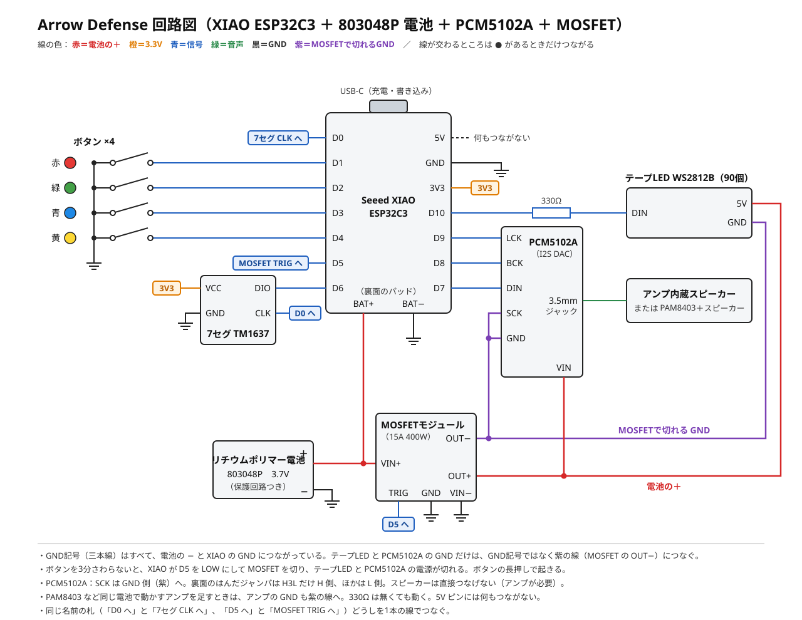

[日本語](README.md) | **English**

# Arrow Defense (LED strip × ESP32-S3 SuperMini and others)

A set of games played on a WS2812B LED strip with four colored buttons: Normal, Pong (2 players / vs CPU), Rhythm and Simon.

Supported boards: **ESP32-S3 SuperMini**, ESP32-C3 SuperMini, Seeeduino XIAO (SAMD21), **Seeed XIAO nRF52840 / XIAO ESP32C3 (with a charging circuit, for battery use)**, and ESP32. The same sketch runs on all of them; pin numbers switch automatically to match the board.

## 7-segment display (TM1637, 4 digits)
| Scene | Display |
|---|---|
| Title | `nor` → Normal high score → `Pon` → `rHY` → Rhythm high score → `CPU` → `nEno` (Simon) → Simon high score (changes every second) |
| Pong | `3--2` while playing (bottom–top). After the game, `P1`/`P2` (`YOU`/`CPU` in the CPU match) ⇔ final score |
| Playing | Score (in Simon, the length you remembered) |
| Normal events | `GO` (start), `L  5` (level), `HEAL` (recovery), `boSS` (blinking boss warning), `nICE` (boss defeated) |
| Rhythm events | `So 1` (song number), `PErF` / `Good` (judgement), `----` (miss) |
| Simon events | `Good` (every 5 steps) |
| Game over | `End` ⇔ score (`bESt` ⇔ score when you set a new high score) |

If you do not use the display, set `USE_7SEG` to 0 in the `.ino`.

## Choosing a mode
On the title screen (four bands of red, green, blue and yellow flow from the bottom), **press a button briefly and release it**:
- **Red → Normal mode**
- **Green → Pong (2 players)**
- **Blue → Rhythm mode**
- **Yellow → Pong (1 player, vs CPU)**

**Hold any button for 1 second → Simon (memory game).** While you hold, a white bar grows from the bottom; the game starts when it reaches the top.

After a game over, the same controls start a new game. High scores are saved separately for Normal, Rhythm and Simon.

## Simon (memory game)
- The strip is split into four colored areas (red, green, blue, yellow from the bottom, the same order as the title bands)
- The areas light up in order with a sound → remember the order and press the buttons in the same order
- The areas get a little brighter when it is your turn. Not pressing for 5 seconds is a failure (they blink for the last 2 seconds)
- When you are right, a green light runs along the strip and the sequence gets one step longer. It also gets faster as it grows
- One mistake ends the game. The **correct color** is shown by blinking
- Score = the length you remembered. The notes are C, E, G, C (red, green, blue, yellow)

## Pong (2-player tennis)
- Bottom player = **red or green button**, top player = **blue or yellow button**
- The lit part at each end of the strip (9 LEDs on a 90-LED strip) is your zone. Hit the ball back with your button when it enters your zone
- **The closer to the end you hit it, the faster the ball goes** (up to +80%, with white sparks). The ball also speeds up as the rally continues
- Swinging too early locks your button for 0.4 seconds (your zone goes dark), so mashing the button does not help
- If the ball leaves the end, the other player scores. The player who lost the point serves the blinking ball with a button (auto-serve after 3 seconds)
- First to 5 points wins. The winner's half lights up
- The score is shown as dots at the middle of the strip and as `3--2` on the display. After the game: `P1` / `P2`

### vs CPU (yellow button)
- You are the bottom player. **Any button** hits the ball. The CPU plays the top
- The CPU **misses more often on fast balls** → the trick is to hit near the end and speed the ball up
- The CPU gets a little weaker when it leads and a little stronger when it is behind (games tend to be close)
- After the game the display shows `YOU` (you won) / `CPU` (you lost)
- Strength settings: `CPU_MISS_MIN` (miss rate on slow balls) and `CPU_MISS_MAX` (miss rate at top speed). Smaller numbers make the CPU stronger

## Rhythm mode
- Notes fall in time with songs (Twinkle Twinkle Little Star → Frog Song → Ode to Joy)
- Press the button of the same color at the moment a note overlaps the white LED 5th from the bottom (the judgement line, which blinks on the beat)
- A hit plays that note, so it feels like you are playing the tune yourself
- Colors: **C, D, E, F = red, green, blue, yellow**; G, A, B, C = red, green, blue, yellow; and so on
- PERFECT 3 points / GOOD 1 point (plus a combo bonus). A missed note or a wrong color is damage
- Three songs make one round; the tempo rises each round. The game ends after 10 damage
- You can add songs by writing a score in `SONGS[]` (e.g. `"C4 D4 E4:4"`; `:number` is the length in eighth notes)

## How to play Normal mode
- Press red to start
- Red, green, blue and yellow arrows fall from the top
- Press the button of the same color to fire a missile → a matching color destroys the arrow (score +1; arrows get faster over time)
- A wrong color, or an arrow reaching the base (the bottom LED), is damage
- The color of the base LED shows your remaining HP (green → yellow → red; it blinks at 3 or less)
- 10 damage is game over → red blinking, then your score is shown

### Extra features
| Feature | Details |
|---|---|
| Combo | Destroying arrows in a row builds a combo. Every 10 combo restores 1 HP (a green light runs). At 10 combo each arrow is worth 2 points, at 20 combo 3 points, and missiles get longer |
| Level | Level up every 10 arrows destroyed (a white light runs). Arrows get faster and more frequent |
| Armor arrow (white tail), Lv2+ | Needs two hits. The first hit pushes it back up |
| Chameleon arrow, Lv3+ | Changes color as it falls. It blinks just before changing |
| Rainbow arrow, Lv2+ | Any color of missile works. It destroys every arrow on the strip! |
| Boss, every 5 levels | After a warning (the top half blinks red), a long boss made of colored segments comes down. Shoot the color of the bottom segment (the pulsing one) each time; destroy them all to win (bonus 10 × boss number, plus 3 HP). A wrong color makes the boss advance. The boss also fires small arrows. If it reaches the base you take 3 damage |
| High score | Kept after power-off. A new record makes the top of the strip sparkle in rainbow colors |
| Sound effects | Played if you connect a passive buzzer (the game works without one) |

### Reading the score on the strip
From the bottom: hundreds = purple, tens = light blue, ones = white, shown as that many LEDs (0 is one dim LED). Example: 127 points → 1 purple, 2 light blue, 7 white.

## Wiring
Circuit diagram (XIAO ESP32C3 + 803048P battery + PCM5102A + MOSFET module): [wiring_xiao_esp32c3.svg](wiring_xiao_esp32c3.svg) (opens in a browser; the labels are in Japanese)



| Part | **ESP32-S3 SuperMini** | ESP32-C3 SuperMini | XIAO (SAMD21 / nRF52840) | XIAO ESP32C3 | ESP32 |
|---|---|---|---|---|---|
| LED strip DIN (data) | **GPIO 10** | GPIO 10 | D10 | D10 | GPIO 5 |
| Red button (to GND) | **GPIO 1** | GPIO 0 | D1 | D1 | GPIO 25 |
| Green button (to GND) | **GPIO 2** | GPIO 1 | D2 | D2 | GPIO 26 |
| Blue button (to GND) | **GPIO 4** | GPIO 3 | D3 | D3 | GPIO 27 |
| Yellow button (to GND) | **GPIO 8** | GPIO 4 | D4 | D4 | GPIO 33 |
| TM1637 CLK | **GPIO 5** | GPIO 5 | D5 | **D0** | GPIO 18 |
| MOSFET module TRIG (optional) | ― | ― | ― | D5 | ― |
| TM1637 DIO | **GPIO 6** | GPIO 6 | D6 | D6 | GPIO 19 |
| TM1637 VCC / GND | **3.3V** / GND | 3.3V / GND | 3V3 / GND | 3V3 / GND | 3.3V / GND |
| Passive buzzer (optional, to GND) | **GPIO 7** | GPIO 7 | D8 | Not used (sound comes from an I2S board; see "Sound from a speaker" below) | GPIO 32 |
| LED strip 5V / GND | External 5V supply (see "Power wiring" below) | Same | Same (for nRF52840 on a battery, see "Running on a lithium battery" below) | See "Running on a lithium battery" below | External 5V supply |

- A 330Ω resistor in series with the strip's DIN makes the signal more stable
- If you do not use a buzzer, set `BUZZER_PIN` to -1. Use a "passive" buzzer (piezo speaker); an active buzzer cannot change pitch

### Notes for ESP32-S3 SuperMini
- **Do not use GPIO 0, 3, 45, 46** (they affect the boot mode; 0 is the BOOT button)
- **GPIO 19 and 20 are USB**, and **GPIO 48 is the on-board RGB LED**, so do not use them
- Signal pins are **3.3V only**. 5V may only go to the "5V" pin
- It looks almost the same as the C3 SuperMini. If the chip says "ESP32-S3", it is an S3

### Notes for ESP32-C3 SuperMini
- **Do not use GPIO 2, 8, 9** (they affect the boot mode; 8 is the on-board blue LED, 9 is the BOOT button). GPIO 20 and 21 are free
- Signal pins are **3.3V only**. 5V may only go to the "5V" pin

### Notes for XIAO
- Signal pins (D0–D10) are **3.3V only**. 5V may only go to the "5V" pin
- D0 (A0) is used as the random seed, so **leave it unconnected**. D7 and D9 are free

### Notes for XIAO ESP32C3
- **Do not connect buttons or similar parts to D0, D8, D9** (they affect the boot mode; D9 is the BOOT button). D8 and D9 are used only as I2S outputs, and D0 only as the display's CLK
- **The display's CLK is on D0, unlike the other XIAO boards** (D5 is used for the MOSFET module). D0 must be HIGH at boot; the pull-up resistors on the TM1637 module take care of that. If the board stops booting with the display connected, add a 10kΩ resistor between D0 and 3V3
- Sound comes from an I2S board and a speaker (D7, D8, D9). To go back to a buzzer, set `USE_I2S` to 0 in the `.ino` and connect the buzzer to **D7**
- Signal pins are **3.3V only**
- Right after power-on, the display may show garbage for a moment (D6 is also the boot-message output pin). It goes back to normal quickly

### Sound from a speaker (I2S: PCM5102A or MAX98357A)
Instead of a buzzer, an I2S board produces the sound. The sketch generates the waveforms itself, so no audio files are needed.

- Differences from the buzzer: a clear, bell-like tone / damage and explosions are noise bursts / up to three sounds can play at once (a jingle is not cut off when you fire)
- Supported boards: **XIAO ESP32C3** (enabled by default), ESP32-S3 SuperMini (set `USE_I2S` to 1 in the S3 section of the `.ino`)

**Using a PCM5102A**

The PCM5102A is a DAC. It only outputs a weak line-level signal, like a headphone jack. **A speaker connected directly will not make sound**, so you need one of these:
- A powered speaker (for a PC or phone) plugged into the board's 3.5mm jack
- A small amplifier board (PAM8403 or similar) and a speaker

| PCM5102A pin | XIAO ESP32C3 | ESP32-S3 SuperMini |
|---|---|---|
| DIN | D7 | GPIO 11 |
| BCK | D8 | GPIO 12 |
| LCK (LRCK) | D9 | GPIO 13 |
| SCK | **Connect to GND** (OUT− when using the MOSFET module) | **Connect to GND** |
| GND | GND (OUT− when using the MOSFET module) | GND |
| VIN | Battery + (same point as the strip's 5V). The 5V pin if you run on USB only | Same |

- **If there is no sound, first check the solder jumpers on the back of the board.** Most boards have four, `H1L`–`H4L`: bridge **only `H3L` to the H side and the other three to the L side** (if `H3L` stays on L, the output is muted). Some boards come already bridged
- Instead of wiring SCK to GND, you can bridge the SCK solder jumper on the front of the board

**Using a MAX98357A** (it has a built-in amplifier, so a 4–8Ω, 2–3W speaker connects directly)

| MAX98357A pin | XIAO ESP32C3 | ESP32-S3 SuperMini |
|---|---|---|
| DIN | D7 | GPIO 11 |
| BCLK | D8 | GPIO 12 |
| LRC | D9 | GPIO 13 |
| GND | GND | GND |
| VIN | Battery + (same point as the strip's 5V). The 5V pin if you run on USB only | Same |
| SD, GAIN | Leave unconnected | Leave unconnected |
| + / − (screw terminal) | Speaker | Speaker |

- Change the volume with `VOLUME` in the `.ino` (0–255, default 100). Too high distorts the sound and drains the battery faster
- If **uploading fails on the XIAO ESP32C3, disconnect the D8 and D9 wires** and try again (these pins affect the boot mode)
- If there is no sound, check that the serial monitor does not show `I2S init failed`, and that the DIN, BCLK and LRC wires are not swapped

### Automatic power-off (MOSFET module, XIAO ESP32C3 only)
An LED strip draws about 1mA per LED even when it is dark (about 80–90mA for 90 LEDs). A **MOSFET module (5V-36V 15A 400W dual MOSFET trigger switch)** on the ground side of the strip and the PCM5102A lets the XIAO cut their power when the game is not in use.

- **After 3 minutes without a button press outside a game**, the strip, DAC and display turn off and the XIAO goes to sleep (set the time with `SLEEP_AFTER_MIN` in the `.ino`)
- **Hold red and yellow together for 2 seconds to power off right away** (works during a game too; set the time with `POWER_HOLD_MS`)
- **Hold any button for 1 second to wake up** (power on; set the time with `POWER_ON_HOLD_MS`). A short press does not wake it. After waking it starts from the title screen, the same as a fresh power-on. High scores are kept

| MOSFET module terminal | Connect to |
|---|---|
| VIN+ | Battery + |
| VIN− (supply-side GND) | Battery − (GND) |
| OUT+ | Strip 5V, PCM5102A VIN |
| OUT− | Strip GND, PCM5102A GND and SCK |
| TRIG (PWM) | XIAO D5 |
| GND (next to TRIG) | GND |

- **Connect the GND of the strip and the PCM5102A to OUT−, not to the normal GND** (if they go straight to GND, the power cannot be cut). If you add an amplifier board on the same battery, its GND also goes to OUT−
- The GND of the buttons, the display and the XIAO stays on battery −, as before
- The module is labelled "5V-36V", but it works at this current with a 3.7V battery and a 3.3V signal. **If the strip is dim or dark, or the module gets hot, the MOSFET is not turning on fully**, so stop using it
- If you do not use this module, set `POWER_PIN` to -1 in the `.ino` and connect the GND of the strip and the PCM5102A to the normal GND

### Using recorded sound effects (material from On-Jin and similar sites)
When sound comes from I2S (the section above), you can build audio files such as MP3 into the sketch. Events without a file keep the sound generated by the sketch.

**Steps**
1. The first time only, run `py -m pip install miniaudio` in a command prompt (the library that reads MP3)
2. **Download the sound effects you like by hand, one at a time**, from [On-Jin](https://on-jin.com/) or a similar site
3. Make a `sounds` folder inside the sketch folder and put the files there, renamed as in the table below (e.g. `fire.mp3`). mp3 / wav / ogg / flac are supported
4. Double-click `make_sounds.bat` → `sounds.h` is created
5. Upload the sketch again from the Arduino IDE

| File name | When it plays | Max length |
|---|---|---|
| `start` | Game start | 1.5 s |
| `fire` | Missile fired / Pong serve | 0.4 s |
| `hit` | Arrow destroyed (the pitch rises with the combo) | 0.5 s |
| `armor` | Hit on an armor arrow | 0.5 s |
| `miss` | Wrong color | 0.6 s |
| `damage` | Damage to the base | 0.8 s |
| `heal` | HP recovery | 1.0 s |
| `levelup` | Level up | 1.5 s |
| `bomb` | Rainbow arrow destroys everything | 1.5 s |
| `gameover` | Game over | 2.5 s |
| `record` | New high score / Pong win | 2.5 s |
| `warning` | Boss warning | 2.5 s |
| `boss_crash` | Boss hits the base | 1.5 s |
| `boss_clear` | Boss defeated | 2.5 s |
| `rhythm_miss` | Miss in Rhythm mode | 0.4 s |
| `pong_point` | Point in Pong | 1.0 s |

- Silence at the start and end is trimmed automatically and the volume is evened out. Anything past the max length is cut, with a smooth fade at the end
- Rhythm notes, Simon tones and the Pong hit sound stay as generated sounds, because their pitch matters
- To go back, delete `sounds.h` and upload again

**Rules for using the material (from the On-Jin terms of use)**
- Use in an individual's own self-made work is free and needs no notice. Processing (format conversion, trimming) is allowed only when the sound is built into a work
- **The material itself, or material that has only been converted, must not be made available to other people.** Do not publish the `sounds` folder or `sounds.h` on GitHub or anywhere else on the internet (this repository's `.gitignore` excludes both)
- Direct links to the audio files are prohibited. Download by hand with the button on the site
- Use by a company or for a commercial business requires contacting the site
- The terms can change, so read the [terms of use](https://on-jin.com/kiyaku.php) (in Japanese) yourself before using the material

Sound material used: On-Jin https://on-jin.com/ (redistribution and unauthorized use of the audio are prohibited)

### Running on a lithium battery (ESP32-S3 SuperMini / XIAO nRF52840 / XIAO ESP32C3)
Battery used: **803048P (3.7V lithium polymer, 8×30×48mm)**. The capacity is usually around 1200mAh (check the label).

With a board that has a charging circuit, you connect the battery to the board and charge it over USB. Wire the signal lines as in the table above and change only the power wiring as follows.

- **On the ESP32-S3 SuperMini, first check that the back of the board has "B+ / B-" pads.** Products with the same name differ; no pads means no charging circuit (in that case use "Boards without a charging circuit" below)
- The XIAO nRF52840 and XIAO ESP32C3 have BAT+ / BAT- pads on the back

```
803048P battery ────┬─ Battery pads on the back of the board (B+ / B-)  ← charged from the board's USB
                    └─ Switch ─ Strip 5V / GND   ← the strip is powered straight from the battery (a MOSFET module can replace the switch)
Board GND ─ Strip GND (common)
```

- **Power the strip straight from the battery.** On battery power the 5V pin has no voltage. The 3V3 pin cannot supply enough current for the strip, so do not use it
- The strip runs at 3.0–4.2V. Blue and white get weaker as the battery runs down. If it is too dim, raise `BRIGHTNESS` in the `.ino`
- **Use a battery with a protection circuit** (the board's charging circuit has no over-discharge or short-circuit protection, and the strip is wired straight to the battery). An 803048P with a small board wrapped in yellow tape at the base of its leads has one
- **Keep `MAX_MILLIAMPS` at 800** (already set). A battery this size can safely supply about 1A at most
- Play time is roughly 3–4 hours on 1200mAh (an estimate)
- **Approximate charging time** (for 1200mAh)
  - nRF52840: 100mA charge current (when `FAST_CHARGE` is 1 in the `.ino`; 50mA when 0). About 13 hours
  - XIAO ESP32C3: nominally about 350mA (fixed). About 4 hours
  - ESP32-S3 SuperMini: about 100mA (fixed). About 13 hours
- **Do not bend, crush or puncture the battery.** Stop using it if it swells
- **Never reverse the battery's + and −.** Reversed polarity destroys the board. There are reports that small parts around the power circuit of the ESP32-S3 SuperMini fail easily, so also take care not to short the 5V pin to GND
- **Turn the strip off while charging** (with the MOSFET module it turns off by itself after 3 minutes without input). If the strip is drawing current, the charger may not detect a full charge correctly
- USB and the battery may be connected at the same time (the charging circuit sits between them, so the "disconnect the 5V wire" step below is not needed)
- ⚠ If you switch to a small battery under 200mAh on the nRF52840, set `FAST_CHARGE` to 0
- On the nRF52840, D0 (A0) is the random seed, so leave it unconnected
- On all of these boards, high scores are kept even after the sketch is uploaded again

### Power wiring (boards without a charging circuit)
Both the SuperMini (S3, C3) and the XIAO have a **5V pin** (printed "5V" on the SuperMini; top right on the XIAO, seen from the USB connector side).
This pin is tied to the USB 5V line: on USB power it **outputs** 5V, and without USB you can **feed** external 5V into it to run the board.

**Finished build (recommended): one external 5V supply for both the strip and the board**
```
5V supply (3A or more) ─┬─ Strip 5V (the bare red wire)
                        └─ Board 5V pin
GND ────────────────────┬─ Strip GND
                        └─ Board GND
```
- 90 LEDs can draw up to about 5.4A (the sketch limits it to `MAX_MILLIAMPS`), so use a supply of **5V 3A or more** (in that case you may raise `MAX_MILLIAMPS` to 1500; the default of 800 is for the battery)

**⚠ Do not connect USB and an external supply at the same time**
- With both connected, current can flow back into the PC's USB port
- **When uploading, disconnect the wire on the board's 5V pin before plugging in USB** (GND can stay connected; the strip keeps running from the external supply)
- If unplugging every time is a nuisance, put a **Schottky diode (1N5817 or similar)** in the 5V-pin wire (anode on the supply side, cathode — the banded end — on the board side). That blocks the reverse current

**Quick test: USB power only**
- If you lower `MAX_MILLIAMPS` to **400** in the `.ino`, you may power the strip from the board's 5V pin (brightness is limited automatically and stays within USB's roughly 500mA)
- Lighting the strip from USB alone with a high `MAX_MILLIAMPS` puts a strain on the board and the PC's USB port

### The five wires of the LED strip
A WS2812B strip usually has "three wires on a connector plus two bare wires".
- The three connector wires: **5V (red) / DIN (green, etc.) / GND (white or black)**
- The two bare wires: **5V (red) and GND (white/black) for power**. They are the same as the connector's 5V/GND, added to carry more current
- Wire colors differ by manufacturer, so always check the "5V / DIN / GND" printed on the strip
- The signal flows in the direction of the arrows (→). Connect the wires at the **tail of the arrows (the DIN end)**; the DO at the other end is not used

Recommended: the two bare wires to the 5V adapter, the connector's DIN to the board's data pin (GPIO 10 on a SuperMini), and the connector's GND to the board's GND.
If the board also runs from the external supply, connect the adapter's 5V to the board's 5V pin (see "Power wiring" above; the connector's 5V can be left unused).

- The buttons use the internal pull-ups, so no resistors are needed
- A capacitor of about 1000µF across the strip's power terminals is a good precaution
- If the signal is unstable, consider a 3.3V→5V level shifter (74AHCT125 or similar)

## Uploading (ESP32-S3 / C3 SuperMini)
1. In the Arduino IDE Boards Manager, install **esp32** (by **Espressif Systems**)
   - "Arduino ESP32 Boards" (by Arduino) is a different package; do not use it
2. Select the board: **ESP32S3 Dev Module** for the S3, **ESP32C3 Dev Module** for the C3
   - Choosing the wrong board gives an upload error such as `This chip is ESP32-S3, not ESP32-C3`
3. In the Tools menu
   - **USB CDC On Boot: Enabled** (without it, nothing appears in the serial monitor)
   - **CPU Frequency: 160MHz or higher** (below 80MHz, FastLED fails with `F_CPU should be at least 80MHz`)
4. In the Library Manager, install **FastLED 3.10.3** and **TM1637** (by Avishay Orpaz)
   - ⚠ FastLED **3.10.7 fails to compile on ESP32**. Pick 3.10.3 in the version box
5. Open `ArrowDefense.ino` and upload
   - If the upload fails, **hold BOOT, press and release RST**, then release BOOT and upload
6. The serial monitor (115200bps) also shows HIT / MISS / score

- High scores are kept after power-off and after the sketch is uploaded again

## Uploading (Seeeduino XIAO)
1. In the Arduino IDE, add this to "Preferences → Additional boards manager URLs":
   `https://files.seeedstudio.com/arduino/package_seeeduino_boards_index.json`
2. In the Boards Manager, install **Seeed SAMD Boards** and select **Seeeduino XIAO**
3. In the Library Manager, install **FastLED**, **TM1637** (by Avishay Orpaz) and **FlashStorage_SAMD** (by Khoi Hoang)
4. Open `ArrowDefense.ino` and upload (if it fails, short the RST pads twice quickly to enter bootloader mode)

- High scores are stored in the XIAO's flash. **Uploading the sketch again erases them** (they are kept after a simple power-off)
- For a regular ESP32, just select an ESP32 board (ESP32 Dev Module, etc.)

- ⚠ FastLED **3.10.9 gives a link error on the XIAO (SAMD21)** (`Conflicting CPU architectures`). Try another version

## Uploading (Seeed XIAO nRF52840)
1. Add the same URL as above to "Additional boards manager URLs"
2. In the Boards Manager, install **Seeed nRF52 Boards** and select **Seeed XIAO nRF52840**
   - "Seeed nRF52 **mbed-enabled** Boards" is a different package; do not use it
3. In the Library Manager, install **FastLED** and **TM1637** (by Avishay Orpaz) (compilation checked with FastLED 3.10.9)
4. Open `ArrowDefense.ino` and upload (if it fails, press the RST button twice quickly to enter bootloader mode)

## Uploading (Seeed XIAO ESP32C3)
1. In the Boards Manager, install **esp32** (by **Espressif Systems**)
2. Select **XIAO_ESP32C3** as the board (with "ESP32C3 Dev Module" the sketch uses the SuperMini pin numbers and does not work)
3. In the Library Manager, install **FastLED** and **TM1637** (by Avishay Orpaz) (compilation checked with FastLED 3.10.9)
4. Open `ArrowDefense.ino` and upload (if it fails, hold BOOT, then press and release RESET)
   - While the board is asleep (powered off by the MOSFET feature), USB serial is also off. Wake it with a long press before uploading

## Settings (the #define lines at the top of the .ino)
- `POWER_PIN` / `SLEEP_AFTER_MIN` / `POWER_HOLD_MS` / `POWER_ON_HOLD_MS` … automatic power-off with the MOSFET module (minutes until sleep, long-press times for off and on)
- `USE_I2S` / `VOLUME` … how sound is produced (1 = I2S board, 0 = buzzer) and the volume
- `FAST_CHARGE` … charge current of the XIAO nRF52840 (1 = 100mA, 0 = 50mA)
- `NUM_LEDS` / `LED_PIN` … match your strip (the default is 90 LEDs; speeds scale with the LED count automatically)
- `MAX_MILLIAMPS` … default 800 (for the 803048P battery). Use 400 for a USB-only test, or up to 1500 with an external 5V 3A supply
- `ARROW_SPEED_*` / `SPAWN_MS_*` … difficulty of Normal mode
- `S_ON_START` / `S_ON_MIN` / `S_INPUT_TIMEOUT` … how fast Simon lights up, and how long it waits
- `SIMON_HOLD_MS` … how long to hold to start Simon
