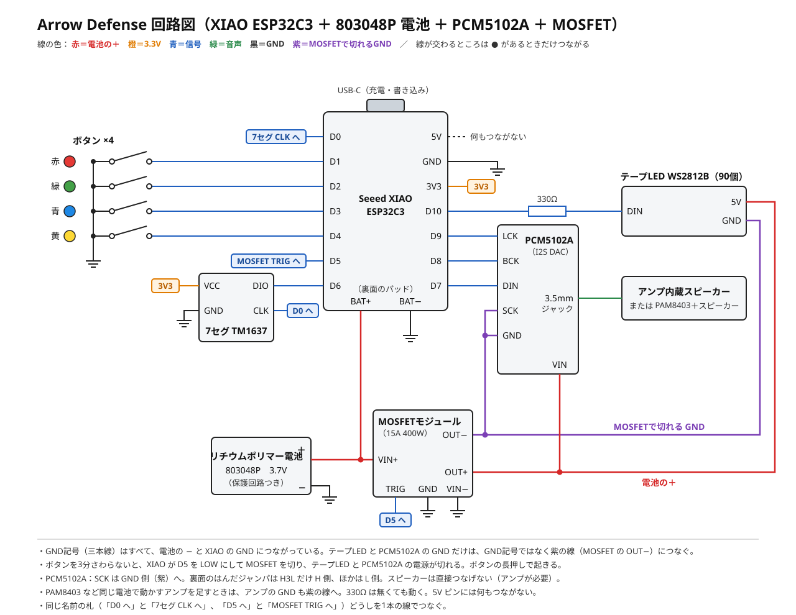

# Arrow Defense（テープLED × ESP32-S3 SuperMini ほか）

対応ボード：**ESP32-S3 SuperMini（使用中）**、ESP32-C3 SuperMini、Seeeduino XIAO (SAMD21)、**Seeed XIAO nRF52840 / XIAO ESP32C3（充電回路つき・電池で動かす場合）**、ESP32。同じスケッチで動き、ピン番号はボードに合わせて自動で切り替わる。

## 7セグ表示（TM1637 4桁）
| 場面 | 表示 |
|---|---|
| タイトル | `nor` → ノーマルのハイスコア → `Pon` → `rHY` → リズムのハイスコア → `CPU` → `nEno`（サイモン） → サイモンのハイスコア（1秒ごと） |
| ポン | プレイ中 `3--2`（下側–上側）、終了後 `P1`/`P2`（CPU対戦は `YOU`/`CPU`）⇔ 最終スコア |
| プレイ中 | スコア（サイモンは覚えた長さ） |
| ノーマルのイベント | `GO`（開始）、`L  5`（レベル）、`HEAL`（回復）、`boSS`（点滅・ボス警告）、`nICE`（ボス撃破） |
| リズムのイベント | `So 1`（曲番号）、`PErF` / `Good`（判定）、`----`（ミス） |
| サイモンのイベント | `Good`（5つごと） |
| ゲームオーバー | `End` ⇔ スコア（ハイスコア更新時は `bESt` ⇔ スコア） |

使わない場合は `.ino` の `USE_7SEG` を 0 に。

## モード選択
タイトル画面（下から 赤・緑・青・黄 の4つの帯が流れる）で、ボタンを**短く押して離す**と
- **赤 → ノーマルモード**
- **緑 → ポン（2人対戦）**
- **青 → リズムモード**
- **黄 → ポン（1人用・CPU対戦）**

どれかのボタンを**1秒長押し → サイモン（記憶ゲーム）**（押している間、下から白いバーが伸びる。てっぺんまで行くとスタート）

ゲームオーバー後も同じ操作で再挑戦できる。ハイスコアはノーマル・リズム・サイモンで別々に保存。

## サイモン（記憶ゲーム）
- テープが4色のエリア（下から 赤・緑・青・黄。タイトルの帯と同じ並び）に分かれる
- エリアが音と一緒に順番に光る → 覚えて、同じ順番でボタンを押す
- 自分の番になるとエリアが少し明るくなる。5秒押さないと失敗（残り2秒で点滅）
- 正解すると緑の光が走り、お手本が1つ長くなる。長くなるほど速くなる
- 1回でも間違えたら終了。**本当は何色だったか**が点滅で表示される
- スコア＝覚えられた長さ。音は ド・ミ・ソ・ド（赤・緑・青・黄）

## ポン（2人対戦テニス）
- 下側プレイヤー = **赤 or 緑ボタン**、上側プレイヤー = **青 or 黄ボタン**
- テープの両端の光っている部分（LED 90個なら9個）が自分の陣地。光の玉が陣地に来たらボタンで打ち返す
- **端ギリギリで打つほど球が速くなる**（最大+80%、白い火花が出る）。ラリーが続くほどさらに加速
- 早すぎる空振りは0.4秒ボタンが効かない（陣地が暗くなる）ので連打は不利
- 玉が端から出たら相手の得点。取られた側が点滅している玉をボタンでサーブ（3秒で自動サーブ）
- 先に5点取った方の勝ち。勝った側の半分が光る
- 得点はテープ中央に点で表示、7セグには `3--2` のように表示、終了後は `P1` / `P2`

### CPU対戦（黄ボタン）
- 自分は下側。**どのボタンでも**打ち返せる。上側はCPU
- CPUは**速い球ほどミスしやすい** → 端ギリギリで打って球を速くするのが攻略のコツ
- CPUがリードすると少し弱く、負けていると少し強くなる（接戦になりやすい）
- 7セグは終了後 `YOU`（勝ち）/ `CPU`（負け）
- 強さの調整：`CPU_MISS_MIN`（遅い球でのミス率）、`CPU_MISS_MAX`（最高速でのミス率）。数字を小さくするほどCPUが強くなる

## リズムモード
- 曲（きらきら星 → かえるの歌 → 歓喜の歌）に合わせて音符が落ちてくる
- 下から5個目の白いLED（判定ライン・拍に合わせて点滅）に重なった瞬間に同じ色のボタン
- 当てるとブザーがその音を鳴らす ＝ 自分で演奏している感覚
- 色は **ド・レ・ミ・ファ ＝ 赤・緑・青・黄**、ソ・ラ・シ・ド ＝ 赤・緑・青・黄 …の繰り返し
- PERFECT 3点 / GOOD 1点（＋コンボボーナス）、見逃し・色違いはダメージ
- 3曲で1周、周回ごとにテンポアップ。ダメージ10回で終了
- 曲は `SONGS[]` に楽譜を書けば追加できる（例 `"C4 D4 E4:4"`、`:数字`は8分音符いくつ分か）

## ノーマルモードの遊び方
- 赤ボタンでスタート
- 上端から 赤/緑/青/黄 の矢印が落ちてくる
- 同じ色のボタンでミサイル発射 → 同じ色なら破壊（スコア+1、だんだん速くなる）
- 色が違う、または矢印が基地（一番下のLED）に届くとダメージ
- 基地LEDの色が残りHP（緑→黄→赤、残り3以下で点滅）
- ダメージ10回でゲームオーバー → 赤点滅のあとスコアを表示

### おもしろ要素
| 要素 | 内容 |
|---|---|
| コンボ | 連続破壊でコンボ。10コンボごとにHP1回復（緑の光が走る）。10コンボで2点/体、20コンボで3点/体、ミサイルも長くなる |
| レベル | 10体破壊ごとにレベルアップ（白い光が走る）。矢印が速く・多くなる |
| アーマー矢印（尾が白）Lv2〜 | 2回当てないと壊れない。1回目は上に押し戻される |
| カメレオン矢印 Lv3〜 | 落ちながら色が変わる。変わる直前に点滅 |
| レインボー矢印（虹色）Lv2〜 | どの色のミサイルでもOK。画面上の矢印を全部破壊！ |
| ボス戦 Lv5ごと | 上半分が赤く点滅する警告のあと、色の節がつながった長いボスが降りてくる。一番下の節（脈打っている）の色を順に撃って全部壊せば撃破（ボーナス10×ボス番号点＋HP3回復）。色を間違えるとボスが前進、ボスは子分の矢印も撃ってくる。基地に到達されると3ダメージ |
| ハイスコア | 電源を切っても保存。更新すると上側が虹色にきらめく |
| 効果音 | パッシブブザーをつなぐと鳴る（なくても動く） |

### スコアの読み方
下から 百の位＝紫、十の位＝水色、一の位＝白 の個数（0は暗い1個）。例：127点 → 紫1・水色2・白7

## 配線
回路図（XIAO ESP32C3 ＋ 803048P 電池 ＋ PCM5102A の構成）：[wiring_xiao_esp32c3.svg](wiring_xiao_esp32c3.svg)（ブラウザで開ける）



| 部品 | **ESP32-S3 SuperMini** | ESP32-C3 SuperMini | XIAO（SAMD21 / nRF52840 共通） | XIAO ESP32C3 | ESP32 |
|---|---|---|---|---|---|
| テープLED DIN（データ） | **GPIO 10** | GPIO 10 | D10 | D10 | GPIO 5 |
| 赤ボタン（― GND） | **GPIO 1** | GPIO 0 | D1 | D1 | GPIO 25 |
| 緑ボタン（― GND） | **GPIO 2** | GPIO 1 | D2 | D2 | GPIO 26 |
| 青ボタン（― GND） | **GPIO 4** | GPIO 3 | D3 | D3 | GPIO 27 |
| 黄ボタン（― GND） | **GPIO 8** | GPIO 4 | D4 | D4 | GPIO 33 |
| 7セグ TM1637 CLK | **GPIO 5** | GPIO 5 | D5 | **D0** | GPIO 18 |
| MOSFETモジュール TRIG（任意） | ― | ― | ― | D5 | ― |
| 7セグ TM1637 DIO | **GPIO 6** | GPIO 6 | D6 | D6 | GPIO 19 |
| 7セグ TM1637 VCC / GND | **3.3V** / GND | 3.3V / GND | 3V3 / GND | 3V3 / GND | 3.3V / GND |
| パッシブブザー（任意、― GND） | **GPIO 7** | GPIO 7 | D8 | 使わない（I2Sアンプで音を出す。下の「スピーカーで音を出す」参照） | GPIO 32 |
| テープLED 5V / GND | 外部5V電源（下の「電源のつなぎ方」参照） | 同じ | 同じ（nRF52840 を電池で使うなら下の「リチウムイオン電池で動かす」参照） | 下の「リチウムイオン電池で動かす」参照 | 外部5V電源 |

- テープLED DIN には 330Ω 抵抗を直列に入れると安定
- ブザーを使わない場合は `BUZZER_PIN` を -1 に。ブザーは「パッシブ（圧電スピーカー）」を使う（アクティブブザーだと音程が変わらない）

### ESP32-S3 SuperMini の注意点
- **GPIO 0・3・45・46 は使わない**（起動モードに関係するピン。0 は BOOT ボタン）
- **GPIO 19・20 は USB**、**GPIO 48 は基板のRGB LED** なので使わない
- 信号ピンは **3.3V専用**。5Vを入れてよいのは「5V」ピンだけ
- 見た目は C3 SuperMini とそっくり。チップに「ESP32-S3」と書いてあれば S3

### ESP32-C3 SuperMini の注意点
- **GPIO 2・8・9 は使わない**（起動モードに関係するピン。8 は基板の青LED、9 は BOOT ボタン）。GPIO 20・21 は空き
- 信号ピンは **3.3V専用**。5Vを入れてよいのは「5V」ピンだけ

### XIAO の注意点
- 信号ピン（D0〜D10）は **3.3V専用**。5Vを入れてよいのは「5V」ピンだけ
- D0（A0）は乱数の種に使うので**何もつながない**。D7・D9 は空き

### XIAO ESP32C3 の注意点
- **D0・D8・D9 にボタンなどをつながない**（起動モードに関係するピン。D9 は BOOT ボタン）。D8・D9 は I2S への出力、D0 は 7セグの CLK としてだけ使う
- **7セグの CLK は他の XIAO と違って D0**（D5 は MOSFETモジュールに使う）。D0 は起動時に HIGH でないといけないが、7セグモジュールについているプルアップ抵抗がその役目をする。もし 7セグをつないだ状態で起動しなくなったら、D0 と 3V3 の間に 10kΩ の抵抗を足す
- 音は I2Sアンプ＋スピーカーで出す（D7・D8・D9）。ブザーに戻したいときは `.ino` の `USE_I2S` を 0 にして、ブザーを **D7** につなぐ
- 信号ピンは **3.3V専用**
- 電源を入れた直後、7セグに一瞬でたらめな表示が出ることがある（D6 が起動メッセージの出力ピンを兼ねているため。すぐ正常に戻る）

### スピーカーで音を出す（I2S：PCM5102A または MAX98357A）
ブザーの代わりに、I2S という方式の基板で音を出す。スケッチの中で音の波形を作るので、音声ファイルは不要。

- ブザーとの違い：鐘のような澄んだ音色になる／ダメージや爆発は「ザッ」というノイズ音になる／音を3つまで重ねて鳴らせる（ジングルの途中で発射音が鳴っても途切れない）
- 対応ボード：**XIAO ESP32C3**（最初から有効）、ESP32-S3 SuperMini（`.ino` の S3 のところの `USE_I2S` を 1 にする）

**PCM5102A（手持ちの基板）を使う場合**

PCM5102A は「DAC」で、イヤホン端子と同じ弱い信号（ライン出力）しか出ない。**スピーカーを直接つないでも鳴らない**ので、次のどちらかが要る。
- アンプ内蔵スピーカー（PC用・スマホ用のもの）を基板の 3.5mm ジャックにつなぐ
- 小型アンプ基板（PAM8403 など）とスピーカーを足す

| PCM5102A の端子 | XIAO ESP32C3 | ESP32-S3 SuperMini |
|---|---|---|
| DIN | D7 | GPIO 11 |
| BCK | D8 | GPIO 12 |
| LCK（LRCK） | D9 | GPIO 13 |
| SCK | **GND につなぐ**（MOSFETモジュールを使うときは OUT−） | **GND につなぐ** |
| GND | GND（MOSFETモジュールを使うときは OUT−） | GND |
| VIN | 電池の＋（テープLEDの 5V と同じところ）。USBだけで動かすなら 5V ピン | 同じ |

- **音が出ないときは、まず基板裏面のはんだジャンパを確認**。売られている基板の多くは `H1L`〜`H4L` の4か所があり、**`H3L` だけ H 側、ほかの3つは L 側**にはんだでつなぐ（`H3L` が L のままだと消音になる）。最初からつないである基板もある
- SCK を GND につなぐ代わりに、基板表面の SCK のはんだジャンパをつないでもよい

**MAX98357A を使う場合**（アンプ内蔵なので、スピーカー（4〜8Ω、2〜3W）を直接つなげる）

| MAX98357A の端子 | XIAO ESP32C3 | ESP32-S3 SuperMini |
|---|---|---|
| DIN | D7 | GPIO 11 |
| BCLK | D8 | GPIO 12 |
| LRC | D9 | GPIO 13 |
| GND | GND | GND |
| VIN | 電池の＋（テープLEDの 5V と同じところ）。USBだけで動かすなら 5V ピン | 同じ |
| SD・GAIN | 何もつながない | 何もつながない |
| ＋ / −（ねじ端子） | スピーカー | スピーカー |

- 音量は `.ino` の `VOLUME`（0〜255、初期値 100）で変える。大きくしすぎると音が割れ、電池も早く減る
- XIAO ESP32C3 で**書き込みに失敗するときは、D8・D9 の線をいったん外して**から書き込む（起動モードに関係するピンのため）
- 音が出ないときは、シリアルモニタに `I2S init failed` と出ていないか、DIN・BCLK・LRC の線が入れ替わっていないかを確認

### 自動で電源を切る（MOSFETモジュール・XIAO ESP32C3 のみ）
テープLEDは消えていても1個あたり約1mA の電気を使い続ける（90個で約80〜90mA）。そこで **MOSFETモジュール（5V-36V 15A 400W デュアルMOSFET トリガースイッチ）** をテープLEDと PCM5102A の GND 側に入れ、使っていないときは XIAO が電源を切る。

- **ゲーム中以外で3分ボタンを押さないと**、テープLED・DAC・7セグが消えて XIAO も眠る（時間は `.ino` の `SLEEP_AFTER_MIN`）
- **赤と黄を同時に2秒長押しすると、すぐに電源が切れる**（ゲーム中でも効く。時間は `POWER_HOLD_MS`）
- **どれかのボタンを1秒長押しすると起きる**（電源ON。時間は `POWER_ON_HOLD_MS`）。短く押しただけでは起きない。起きると電源を入れ直したときと同じくタイトル画面から始まる。ハイスコアは残る

| MOSFETモジュールの端子 | つなぐ先 |
|---|---|
| VIN+ | 電池の＋ |
| VIN−（電源側の GND） | 電池の −（GND） |
| OUT+ | テープLED の 5V、PCM5102A の VIN |
| OUT− | テープLED の GND、PCM5102A の GND と SCK |
| TRIG（PWM） | XIAO の D5 |
| GND（TRIG のとなり） | GND |

- **テープLED と PCM5102A の GND は、ふつうの GND ではなく OUT− につなぐ**（ここを GND に直接つなぐと電源が切れなくなる）。同じ電池で動かすアンプ基板を足すときも、アンプの GND は OUT− へ
- ボタン・7セグ・XIAO の GND は、今までどおり電池の − へ
- モジュールの表示は「5V-36V」だが、3.7V の電池と 3.3V の信号でも、このくらいの電流なら動くはず。**もしテープが暗い・点かない・モジュールが熱くなるときは、MOSFET が十分にオンになっていない**ので使用をやめる
- このモジュールを使わないときは、`.ino` の `POWER_PIN` を -1 にして、テープLED と PCM5102A の GND をふつうの GND につなぐ

### 録音された効果音を使う（On-Jin ～音人～ などの素材）
I2S で音を出しているとき（上の節）は、MP3 などの音声ファイルをスケッチに組み込んで鳴らせる。ファイルを用意しなかった場面は、今までどおりスケッチが作る音が鳴る。

**手順**
1. 最初の1回だけ、コマンドプロンプトで `py -m pip install miniaudio` を実行（MP3 を読むための部品）
2. [On-Jin ～音人～](https://on-jin.com/) などから好きな効果音を**1つずつ手でダウンロード**する
3. スケッチのフォルダに `sounds` フォルダを作り、下の表の名前に変えて入れる（例：`fire.mp3`）。mp3 / wav / ogg / flac が使える
4. `make_sounds.bat` をダブルクリック → `sounds.h` ができる
5. Arduino IDE でスケッチを書き込み直す

| ファイル名 | 鳴る場面 | 最大の長さ |
|---|---|---|
| `start` | ゲーム開始 | 1.5秒 |
| `fire` | ミサイル発射／ポンのサーブ | 0.4秒 |
| `hit` | 矢印を破壊（コンボが続くと音が高くなる） | 0.5秒 |
| `armor` | アーマーに当たった | 0.5秒 |
| `miss` | 色ちがいのミス | 0.6秒 |
| `damage` | 基地にダメージ | 0.8秒 |
| `heal` | HP回復 | 1.0秒 |
| `levelup` | レベルアップ | 1.5秒 |
| `bomb` | レインボーで全部破壊 | 1.5秒 |
| `gameover` | ゲームオーバー | 2.5秒 |
| `record` | ハイスコア更新／ポンの勝利 | 2.5秒 |
| `warning` | ボス警告 | 2.5秒 |
| `boss_crash` | ボスが基地に衝突 | 1.5秒 |
| `boss_clear` | ボス撃破 | 2.5秒 |
| `rhythm_miss` | リズムモードのミス | 0.4秒 |
| `pong_point` | ポンの得点 | 1.0秒 |

- 前後の無音は自動で切り、音量もそろえる。最大の長さを超えた分は切って、終わりをなめらかに消す
- リズムモードの音符、サイモンの音、ポンの打球音は、音の高さが大事なのでスケッチが作る音のまま
- 元に戻したいときは `sounds.h` を消して書き込み直す

**素材を使うときの決まり（On-Jin ～音人～ の利用規約より）**
- 個人の自主制作作品に組み込んで使うのは無料で、連絡も不要。加工（形式の変換・切り取り）も、作品に組み込む場合に限ってよい
- **素材そのもの、または変換しただけのものを、ほかの人が手に入れられる状態にしてはいけない**。`sounds` フォルダと `sounds.h` は、GitHub などインターネットに公開しないこと
- 音声ファイルへの直リンクは禁止。ダウンロードはサイトのボタンから手で行う
- 会社や営利の事業で使う場合は、サイトへの連絡が必要
- 規約は変わることがあるので、使う前に [利用規約](https://on-jin.com/kiyaku.php) を自分でも確認する

使用した効果音素材：On-Jin ～音人～ https://on-jin.com/ （音源の二次配布・無断利用は禁止）

### リチウムイオン電池で動かす（ESP32-S3 SuperMini / XIAO nRF52840 / XIAO ESP32C3）
使う電池：**803048P（3.7V リチウムポリマー、8×30×48mm）**。容量はふつう 1200mAh 前後（電池のラベルで確認）。

充電回路つきのボードなら、電池をボードにつないで USB から充電できる。信号線は上の表のとおりに配線し、電源だけ下のように変える。

- **ESP32-S3 SuperMini は、まず基板の裏面に「B+ / B-」のパッドがあるか確認する**。同じ名前でも作りの違う製品があり、パッドがなければ充電回路なし（その場合は下の「充電回路なしのボード」の方法で）
- XIAO nRF52840 / XIAO ESP32C3 は裏面に BAT+ / BAT- パッドがある

```
803048P 電池 ───────┬─ ボード裏面の電池パッド（B+ / B-）  ← 充電はボードのUSBから
                    └─ スイッチ ─ テープLED 5V / GND      ← テープは電池から直接とる（スイッチの代わりに MOSFETモジュールでもよい）
ボードの GND ─ テープLED GND（共通）
```

- **テープLEDは電池から直接とる**。電池で動いているとき 5V ピンには電圧が出ない。3V3 ピンはテープの電流に足りないので使わない
- テープは 3.0〜4.2V で光ることになる。電池が減ると青・白が弱くなる。暗ければ `.ino` の `BRIGHTNESS` を上げる
- **保護回路つきの電池を使う**（ボードの充電回路には過放電・短絡の保護がなく、テープは電池に直結になるため）。803048P はリード線の根元に黄色いテープで巻かれた小さな基板があれば保護回路つき
- **`MAX_MILLIAMPS` は 800 に**（設定済み）。この大きさの電池が安全に流せるのは 1A 前後まで
- 遊べる時間は 1200mAh で 3〜4 時間くらい（概算）
- **充電時間の目安**（1200mAh の場合）
  - nRF52840：充電電流 100mA（`.ino` の `FAST_CHARGE` が 1 のとき。0 にすると 50mA）。13時間くらい
  - XIAO ESP32C3：充電電流は公称で約350mA（変更不可）。4時間くらい
  - ESP32-S3 SuperMini：充電電流は約100mA（変更不可）。13時間くらい
- **電池を曲げない・押しつぶさない・とがった物を当てない**。ふくらんできたら使用をやめる
- **電池の＋－を絶対に間違えない**。逆につなぐとボードが壊れる。ESP32-S3 SuperMini は電源まわりの小さな部品が壊れやすいという報告があるので、5V ピンと GND のショートにも注意
- **充電中はテープのスイッチを切る**（MOSFETモジュールなら、3分さわらなければ自動で切れる。テープが電気を使っていると満充電の判定がうまくいかないことがある）
- USB と電池は同時につないでよい（充電回路が間に入っているので、下の「5Vピンの線を外す」手順は不要）
- ⚠ nRF52840 で 200mAh 未満の小さい電池に替えるときは `FAST_CHARGE` を 0 にする
- nRF52840 は D0（A0）を乱数の種に使うので何もつながない
- どのボードもハイスコアはスケッチを書き込み直しても残る

### 電源のつなぎ方（充電回路なしのボード）
SuperMini（S3・C3）も XIAO も **5V ピン**がある（SuperMini は基板に「5V」と印刷、XIAO は USB端子側から見て右上）。
このピンは USB の 5V とつながっていて、USB給電時は5Vが**出てくる**、USBなしなら外部5Vを**入れて**ボードを動かせる。

**完成版（おすすめ）：外部5V電源1つでテープもボードも動かす**
```
5V電源(3A以上) ─┬─ テープLED 5V（むき出しの赤）
               └─ ボードの 5Vピン
GND ───────────┬─ テープLED GND
               └─ ボードの GND
```
- テープLED 90個は最大で約5.4A流れるので（スケッチが `MAX_MILLIAMPS` までに抑える）、電源は **5V 3A以上**（その場合は `MAX_MILLIAMPS` を 1500 に上げてよい。初期値は電池用の 800）

**⚠ USBと外部電源を同時につながない**
- 外部電源とUSBを同時につなぐと、PCのUSBに電気が逆流するおそれがある
- **書き込むときはボードの 5V ピンの線を外してから USB をつなぐ**（GNDはつないだままでOK。テープは外部電源で光ったまま使える）
- 毎回抜くのが面倒なら、5Vピンの線の途中に**ショットキーダイオード（1N5817 など）**を入れる（電源側＝アノード、ボード側＝カソード（帯のある側））。これで逆流しない

**ちょっと試すだけ：USBだけで動かす**
- `.ino` の `MAX_MILLIAMPS` を **400** に下げれば、ボードの 5V ピンからテープに給電してもよい（明るさが自動で抑えられ、USBの約500mA以内に収まる）
- `MAX_MILLIAMPS` を上げたまま USB だけで光らせると、ボードやPCのUSBに負担がかかるので注意

### テープLEDの5本の線
WS2812Bテープは通常「コネクタ付き3本 ＋ 先がむき出しの2本」。
- コネクタの3本：**5V（赤）／DIN（緑など）／GND（白または黒）**
- むき出しの2本：**電源用の5V（赤）とGND（白/黒）**。中身はコネクタの5V/GNDと同じで、太い電流を流すための追加線
- 線の色はメーカーで違うので、必ずテープ基板に印刷された「5V / DIN / GND」で確認
- 矢印（→）が向いている方へ信号が流れる。矢印の**根元側（DIN側）**の線をつなぐ（反対側のDOは使わない）

おすすめ：むき出しの2本を5Vアダプタへ、コネクタのDINをボードのデータピン（SuperMini なら GPIO 10）へ、コネクタのGNDをボードのGNDへ。
ボードも外部電源で動かすなら、5Vアダプタの5Vをボードの5Vピンへ（上の「電源のつなぎ方」参照。コネクタの5Vは使わなくてよい）

- ボタンは内部プルアップを使うので抵抗不要
- テープの電源端子に 1000µF 程度のコンデンサを入れると安心
- 信号が不安定なら 3.3V→5V のレベル変換（74AHCT125 など）を検討

## 書き込み（ESP32-S3 / C3 SuperMini）
1. Arduino IDE のボードマネージャで **esp32**（作者 **Espressif Systems**）をインストール
   - 「Arduino ESP32 Boards（作者 Arduino）」は別物なので使わない
2. ボードを選ぶ：S3 なら **ESP32S3 Dev Module**、C3 なら **ESP32C3 Dev Module**
   - 違うボードを選ぶと書き込み時に `This chip is ESP32-S3, not ESP32-C3` のようなエラーになる
3. 「ツール」メニューで
   - **USB CDC On Boot: Enabled**（これを忘れるとシリアルモニタに何も出ない）
   - **CPU Frequency: 160MHz 以上**（80MHz未満だと FastLED が `F_CPU should be at least 80MHz` エラー）
4. ライブラリマネージャで **FastLED 3.10.3** と **TM1637**（作者 Avishay Orpaz）をインストール
   - ⚠ FastLED **3.10.7 は ESP32 でコンパイルエラー**になる。バージョン欄で 3.10.3 を選ぶ
5. `ArrowDefense.ino` を開いて書き込み
   - 書き込めないときは **BOOT ボタンを押したまま RST ボタンを押して離し**、そのあと BOOT を離してから書き込む
6. シリアルモニタ（115200bps）でHIT/MISS/スコアも確認可能

- ハイスコアは電源を切っても、スケッチを書き込み直しても残る

## 書き込み（Seeeduino XIAO）
1. Arduino IDE の「環境設定 → 追加のボードマネージャのURL」に
   `https://files.seeedstudio.com/arduino/package_seeeduino_boards_index.json` を追加
2. ボードマネージャで **Seeed SAMD Boards** をインストールし、ボードに **Seeeduino XIAO** を選ぶ
3. ライブラリマネージャで **FastLED**、**TM1637**（作者 Avishay Orpaz）、**FlashStorage_SAMD**（作者 Khoi Hoang）をインストール
4. `ArrowDefense.ino` を開いて書き込み（書き込めないときは RST パッドを素早く2回ショートすると書き込みモードになる）

- ハイスコアは XIAO のフラッシュに保存される。**スケッチを書き込み直すとハイスコアは消える**（電源を切っただけなら残る）
- 普通の ESP32 で使う場合は ESP32 ボード（ESP32 Dev Module など）を選ぶだけ

- ⚠ FastLED **3.10.9 は XIAO (SAMD21) でリンクエラー**（`Conflicting CPU architectures`）になる。別のバージョンを試す

## 書き込み（Seeed XIAO nRF52840）
1. 上と同じURLを「追加のボードマネージャのURL」に追加
2. ボードマネージャで **Seeed nRF52 Boards** をインストールし、ボードに **Seeed XIAO nRF52840** を選ぶ
   - 「Seeed nRF52 **mbed-enabled** Boards」は別物なので使わない
3. ライブラリマネージャで **FastLED** と **TM1637**（作者 Avishay Orpaz）をインストール（FastLED 3.10.9 でコンパイル確認済み）
4. `ArrowDefense.ino` を開いて書き込み（書き込めないときは RST ボタンを素早く2回押すと書き込みモードになる）

## 書き込み（Seeed XIAO ESP32C3）
1. ボードマネージャで **esp32**（作者 **Espressif Systems**）をインストール
2. ボードに **XIAO_ESP32C3** を選ぶ（「ESP32C3 Dev Module」を選ぶと SuperMini 用のピン番号になってしまい動かない）
3. ライブラリマネージャで **FastLED** と **TM1637**（作者 Avishay Orpaz）をインストール（FastLED 3.10.9 でコンパイル確認済み）
4. `ArrowDefense.ino` を開いて書き込み（書き込めないときは BOOT ボタンを押したまま RESET を押して離す）

## 調整ポイント（.ino 先頭の #define）
- `POWER_PIN` / `SLEEP_AFTER_MIN` … MOSFETモジュールで自動で電源を切る機能（何分で眠るか）
- `USE_I2S` / `VOLUME` … 音の出し方（1 = I2Sアンプ、0 = ブザー）と音量
- `FAST_CHARGE` … XIAO nRF52840 の充電電流（1 = 100mA、0 = 50mA）
- `NUM_LEDS` / `LED_PIN` … 使うテープに合わせる（初期値は90個。速さは個数に合わせて自動で変わる）
- `MAX_MILLIAMPS` … 初期値 800（803048P 電池用）。USB給電だけで試すなら 400 に、外部5V 3A電源なら 1500 にしてよい
- `ARROW_SPEED_*` / `SPAWN_MS_*` … ノーマルの難易度
- `S_ON_START` / `S_ON_MIN` / `S_INPUT_TIMEOUT` … サイモンの光る速さ・待ち時間
- `SIMON_HOLD_MS` … サイモンを始める長押しの時間
